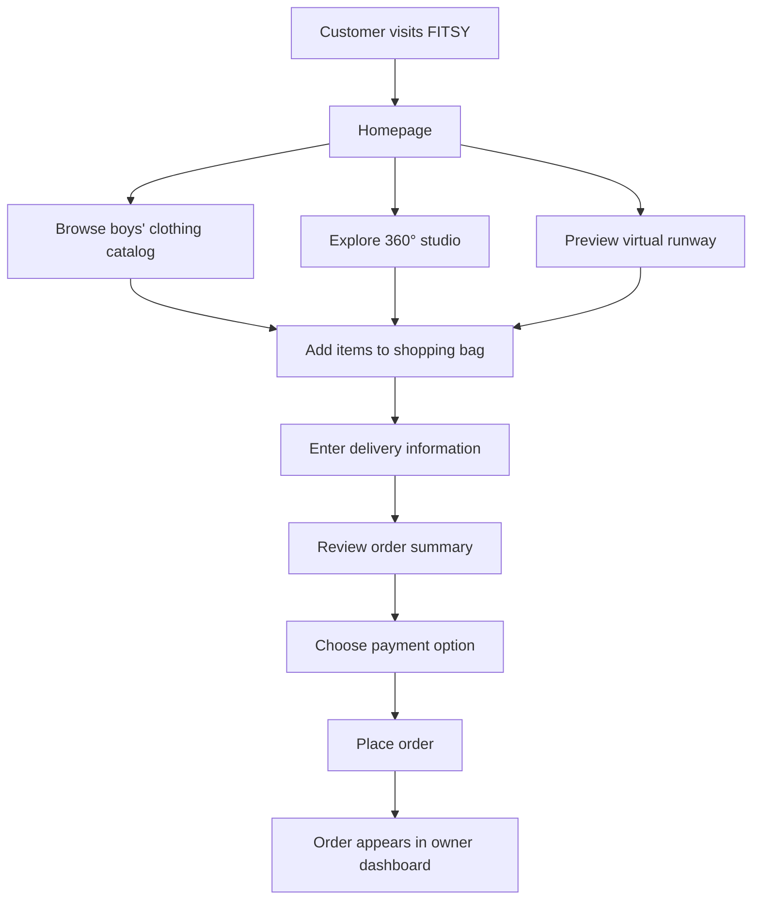
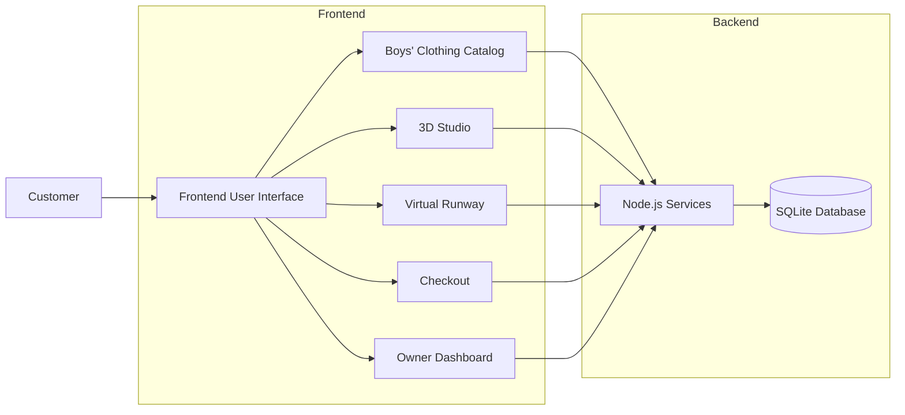

# 👦🏻👕  FITSY'  👗👧

### Fashion & 3D Runway Clothing Portal

**Fresh styles. Interactive shopping. Made for boys.**

Browse boys’ clothing, explore garments in 3D, preview runway outfits, and manage store orders—all in one place.

---

## 📖 Table of Contents

- [Project Overview](#-project-overview)
- [Objectives](#-objectives)
- [Features](#-features)
- [Technology Stack](#️-technology-stack)
- [System Workflow](#-system-workflow)
- [System Architecture](#️-system-architecture)
- [Project Modules](#-project-modules)
- [Benefits](#-benefits)
- [Future Enhancements](#-future-enhancements)
- [Learning Outcomes](#-learning-outcomes)
- [Team Members](#-team-members)
- [Project Information](#-project-information)
- [Conclusion](#-conclusion)

---

## 📌 Project Overview

**FITSY** is a digital fashion and shopping portal focused on boys’ clothing. It gives customers a way to browse clothing collections, explore garment designs from different angles, and preview outfit combinations through a virtual runway experience.

The project also includes an owner dashboard for managing products, runway demonstrations, and customer orders. FITSY brings fashion browsing, 3D garment visualization, checkout, and store management together in one platform.

---

## 🎯 Objectives

- Create a centralized platform for boys’ clothing and online shopping.
- Provide interactive 3D and 360° garment visualization.
- Help customers explore garment designs from the front and back.
- Let customers preview and style outfits through a virtual runway.
- Build a clear and user-friendly shopping experience.
- Organize products, runway collections, and customer orders.
- Provide a dashboard for store owners to manage store activity.
- Apply modern web development and 3D visualization concepts.

---

## 🚀 Features

| Feature | Description |
|---|---|
| 👕 **Boys’ Clothing Catalog** | Browse boys’ fashion collections with category filters and search. |
| 🔄 **360° Studio View** | Explore garments interactively with front and back views. |
| 🧢 **Virtual Runway** | Preview and style outfits on virtual models. |
| 📊 **Owner Dashboard** | Manage products, runway demonstrations, and customer orders. |
| 📍 **Smart Checkout** | Enter delivery details, select a location, and review the order. |
| 💳 **Payment Options** | Present QR-based and card payment options. |
| 📦 **Order Management** | View and organize customer orders through the owner interface. |
| 📱 **Responsive Design** | Support browsing on desktop and mobile screen sizes. |

---

## 🛠️ Technology Stack

| Technology | Purpose |
|---|---|
| **HTML5** | Web page structure and semantic markup. |
| **CSS3** | Styling, responsive layouts, animations, and visual presentation. |
| **JavaScript** | Interactive features and application logic. |
| **Three.js** | 3D garment visualization and interactive product rotation. |
| **WebGL** | Hardware-accelerated 3D rendering. |
| **Node.js** | Backend server and API management. |
| **SQLite** | Persistent storage for products, orders, and user accounts. |
| **Git & GitHub** | Version control and project collaboration. |

---

## 🛒 System Workflow

---

## 🏗️ System Architecture

---

## 📦 Project Modules

| Module | Main Responsibility | Technology |
|---|---|---|
| **Homepage** | Main storefront and navigation. | HTML, CSS, JavaScript |
| **Catalog Module** | Boys’ clothing collections, search, and filters. | HTML, CSS, JavaScript |
| **3D Studio Module** | Interactive 360° garment visualization. | Three.js, WebGL |
| **Runway Module** | Virtual models and outfit styling. | HTML, CSS, JavaScript |
| **Checkout Module** | Delivery details, location selection, and order summary. | HTML, CSS, JavaScript |
| **Owner Dashboard** | Product, demo, and order management. | HTML, CSS, JavaScript |
| **Backend Module** | API handling and application data management. | Node.js |
| **Database Module** | Storage for products, accounts, and orders. | SQLite |

---

## 💡 Benefits

### 👕 Fashion for Boys
Provides a dedicated place to browse boys’ clothing and outfit styles.

### 🔄 Interactive Product Viewing
Lets customers explore garment designs through front, back, and 360° views.

### 🛍️ Convenient Shopping
Brings browsing, outfit previews, and ordering into one platform.

### 📱 Accessible Experience
Uses responsive layouts and clear navigation for different screen sizes.

### 📊 Store Management
Gives store owners a dedicated interface for products, demonstrations, and orders.

---

## 🔮 Future Enhancements

- Add camera-based virtual try-on.
- Explore augmented reality outfit previews.
- Integrate a live payment gateway.
- Add courier tracking and delivery updates.
- Add product ratings and customer reviews.
- Send automated order notifications.
- Suggest outfits based on customer preferences.
- Add sales reports and inventory insights.

---

## 🎓 Learning Outcomes

This project provides experience with:

- Semantic HTML and modern CSS.
- Responsive web design.
- JavaScript-based interactive features.
- 3D rendering with Three.js and WebGL.
- Shopping cart and checkout workflows.
- Backend development with Node.js.
- Database storage with SQLite.
- Git and GitHub version control.
- The structure of an e-commerce application.

---

## 👥 Team Members

| Student ID | Name |
|:---:|:---|
| 2620030089 | Manideep |
| 2620030105 | Gowtham Sai |
| 2620030104 | Vishwak |

---

## 🧾 Project Information

| Item | Details |
|---|---|
| **Project Name** | FITSY — Boys’ Fashion & 3D Runway Clothing Portal |
| **Project Domain** | Web Development · E-Commerce · 3D Visualization |
| **Project Type** | Full-Stack Web Application |
| **Technologies** | HTML5, CSS3, JavaScript, Three.js, WebGL, Node.js, SQLite |

---

## 🏁 Conclusion

FITSY demonstrates how web development and 3D graphics can create a more interactive boys’ clothing shopping experience. By combining product browsing, garment visualization, virtual runway styling, checkout, and store management, the project provides a foundation for a modern digital fashion platform.

---

👦🏻👕 **FITSY — Fresh Fashion, Interactive Style.**

*Developed with ❤️ using modern web technologies.*

